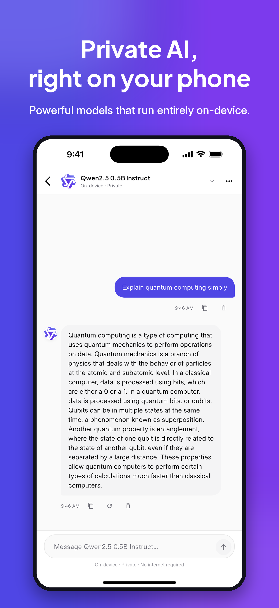
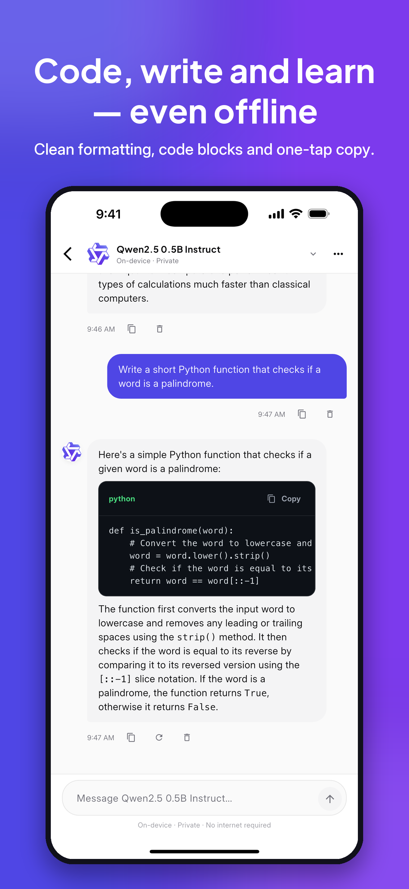
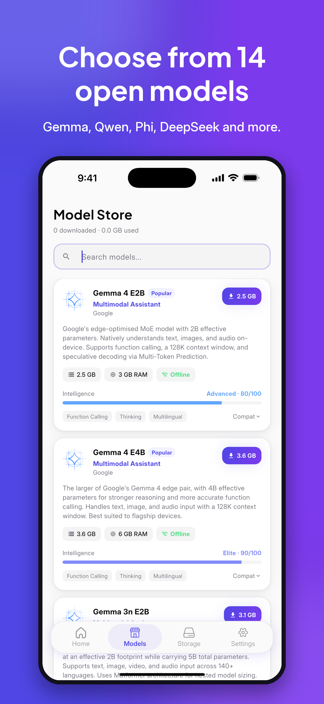
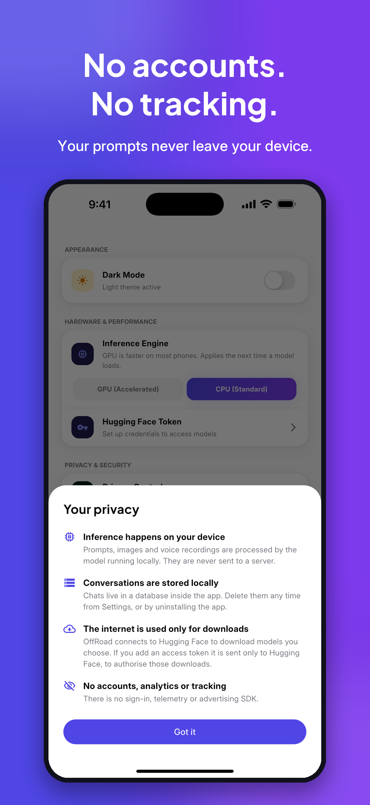
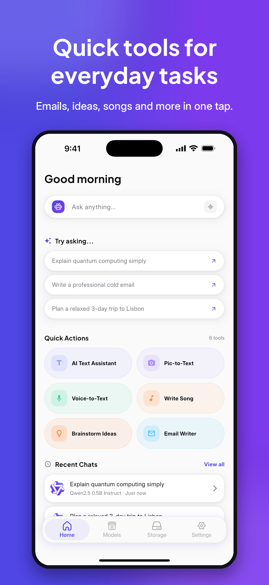
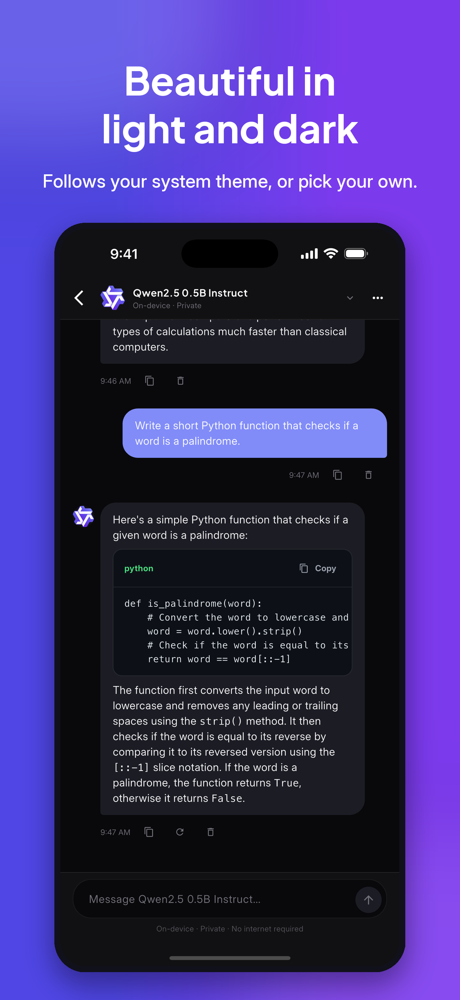

<div align="center">
  

  <h1>OffRoad</h1>
  <p><strong>Private AI. Anywhere. Anytime.</strong></p>

  <p>
    OffRoad runs powerful open AI models — Gemma, Qwen, Phi, DeepSeek and more —<br>
    <strong>entirely on your iPhone or Android phone.</strong> No internet after download.<br>
    No accounts. No telemetry. No servers to breach.
  </p>

  <p>
    <a href="#-screenshots"></a>
    
    
    
    
    
  </p>
</div>

---

## What is OffRoad?

Most AI apps send everything you type to a server — your questions, your images, your voice. OffRoad does the opposite. The model runs inside your phone, your words never leave it, and everything keeps working in airplane mode, underground, off-grid.

It's a fully-featured AI chat app:

- 💬 **Chat** with streaming replies, stop/regenerate, conversation history
- 🖼️ **Vision** — attach a photo; vision models describe, read or explain it
- 🎙️ **Voice mode** — speak, the model answers, the reply is read aloud offline
- 🧠 **Reasoning** — see the model think step-by-step before it answers
- ⚡ **GPU or CPU** — choose the inference backend in settings
- 🌙 **Light & dark** — follows your system, or pin your preference
- 🗑️ **Your data, your rules** — delete a message, a chat, or everything at once

---

## 📱 Screenshots

<table>
  <tr>
    <td align="center"><br><sub>Chat</sub></td>
    <td align="center"><br><sub>Code</sub></td>
    <td align="center"><br><sub>Model Store</sub></td>
    <td align="center"><br><sub>Privacy</sub></td>
    <td align="center"><br><sub>Home</sub></td>
    <td align="center"><br><sub>Dark mode</sub></td>
  </tr>
</table>

> **Demo video** is at [`mobile/store_assets/video/appstore_preview_iphone_886x1920.mp4`](mobile/store_assets/video/appstore_preview_iphone_886x1920.mp4) — open it locally to see the app in action.

---

## 🧠 Available Models

14 open-weight models, downloadable straight from the app:

| Model | Maker | Best for | Size | RAM |
|-------|-------|----------|------|-----|
| **Gemma 4 E2B** ⭐ | Google | Multimodal (text + image + audio) | 2.5 GB | 3 GB |
| **Gemma 4 E4B** | Google | Multimodal — flagship quality | 3.6 GB | 6 GB |
| Gemma 3n E2B | Google | Multimodal (HF token required) | 3.1 GB | 2 GB |
| Gemma 3n E4B | Google | Multimodal (HF token required) | 6.3 GB | 3 GB |
| Gemma3 1B | Google | General chat (HF token required) | 996 MB | 2 GB |
| Gemma3 270M | Google | Lightweight (HF token required) | 293 MB | 1 GB |
| FunctionGemma 270M | Google | Function calling | 264 MB | 1 GB |
| **Qwen3 0.6B** | Alibaba | Reasoning, fast | 572 MB | 1 GB |
| Qwen2.5 1.5B Instruct | Alibaba | General + code | 1.6 GB | 2 GB |
| **Qwen2.5 0.5B Instruct** 🏁 | Alibaba | Best starter model | 501 MB | 1 GB |
| SmolLM 135M Instruct | HuggingFace | Ultra-lightweight | 137 MB | 1 GB |
| Phi-4-mini-instruct | Microsoft | Reasoning + coding | 3.9 GB | 4 GB |
| DeepSeek R1 Distill Qwen 1.5B | DeepSeek | Step-by-step reasoning | 1.8 GB | 4 GB |
| FastVLM 0.5B | Apple | Vision-language | 537 MB | 2 GB |

> 🏁 **Start here** if you're new — Qwen2.5 0.5B is 501 MB and works on any supported phone.  
> 🔒 Models marked "HF token required" need a free [Hugging Face](https://huggingface.co) account + a read token in Settings.

---

## 🚀 Running the App — Quick Start

```bash
# 1. Clone
git clone <repository-url> && cd offroad/mobile

# 2. Install pinned Flutter SDK
dart pub global activate fvm
fvm install          # installs Flutter 3.44.0

# 3. Get packages
fvm flutter pub get

# 4. iOS only — CocoaPods
cd ios && pod install && cd ..

# 5. Run (connect a physical device first!)
fvm flutter run
```

---

## 📋 Full Prerequisites

### Tools

| Tool | Version | How to install |
|------|---------|----------------|
| **FVM** | latest | `brew install fvm` or `dart pub global activate fvm` |
| **Flutter** | `3.44.0` (auto-installed via FVM) | `fvm install` inside `mobile/` |
| **Xcode** | 15+ | Mac App Store |
| **CocoaPods** | latest | `sudo gem install cocoapods` |
| **Android Studio** | latest | [developer.android.com/studio](https://developer.android.com/studio) |
| **Java** | 11+ | Bundled with Android Studio |

### Device requirements

| Platform | OS | CPU | RAM |
|----------|----|-----|-----|
| **iOS** | iOS 16+ | arm64 (physical device — **Simulator cannot run inference**) | 4 GB+ (6 GB+ for larger models) |
| **Android** | Android 11+ (API 30+) | arm64-v8a (build filters this automatically) | 4 GB+ (6 GB+ for larger models) |

---

## 🍎 Running on iOS — Step by Step

### 1. Connect a physical iPhone

Plug in via USB. When prompted on the iPhone, tap **Trust this computer**.

### 2. Set a signing team (first time only)

```bash
open ios/Runner.xcworkspace
```

In Xcode: select the **Runner** target → **Signing & Capabilities** → set your **Team**. A personal Apple ID works for development.

### 3. Run

```bash
fvm flutter devices           # verify your iPhone appears
fvm flutter run               # builds and installs
fvm flutter run -d <id>       # if you have multiple devices
```

### 4. Trust the app (first install only)

**iPhone → Settings → General → VPN & Device Management → [Your Apple ID] → Trust**

---

## 🤖 Running on Android — Step by Step

### 1. Enable Developer Options

`Settings → About Phone` → tap **Build Number** 7 times → go back to `Settings → Developer Options` → enable **USB Debugging**.

### 2. Connect and verify

```bash
adb devices
# Your device should appear as "device", not "unauthorized"
```

If it shows `unauthorized`, accept the debugging prompt on your phone.

### 3. Run

```bash
fvm flutter run
```

> The build targets `arm64-v8a` only — this covers virtually all modern Android phones. If your device isn't arm64, the install will fail.

### Optional: build a release APK

```bash
fvm flutter build apk --release
# or App Bundle for Play Store
fvm flutter build appbundle --release
```

---

## 🔧 Troubleshooting

<details>
<summary><strong>pod install fails — CDN: trunk timeout</strong></summary>

```bash
pod repo remove trunk
pod setup
pod install
```
</details>

<details>
<summary><strong>"No supported devices connected"</strong></summary>

- iOS: device must be trusted. Check `fvm flutter devices`.
- Android: accept the USB debugging prompt on the device. Check `adb devices`.
- Try a different cable — data transfer cables only, not charge-only.
</details>

<details>
<summary><strong>iOS: "Minimum deployment target" build error</strong></summary>

Open `ios/Runner.xcworkspace` in Xcode, select the Runner target, and set **Minimum Deployments → iOS 16.0**. The Podfile already declares this but Xcode can drift.
</details>

<details>
<summary><strong>MissingPluginException at runtime</strong></summary>

```bash
fvm flutter clean
fvm flutter pub get
cd ios && pod install && cd ..
fvm flutter run
```
</details>

<details>
<summary><strong>Android Gradle OOM</strong></summary>

`gradle.properties` already sets `-Xmx8G`. If you still run out, close other JVM processes. You can raise the limit further in `android/gradle.properties`.
</details>

<details>
<summary><strong>Model loads then crashes immediately</strong></summary>

The device is out of RAM. Close all background apps and retry. Switch to a smaller model like Qwen2.5 0.5B (501 MB, 1 GB RAM).
</details>

<details>
<summary><strong>Microphone permission denied (iOS)</strong></summary>

The Podfile injects `PERMISSION_MICROPHONE=1`. If the permission still isn't granted, go to **iPhone Settings → Privacy → Microphone** and enable OffRoad manually.
</details>

<details>
<summary><strong>Gated model download fails (403)</strong></summary>

Some Google Gemma models require accepting a licence on Hugging Face first:
1. Sign in at [huggingface.co](https://huggingface.co) and accept the model's licence
2. Create a free read-only access token
3. In the app: **Settings → Hugging Face Token** → paste it
</details>

---

## 🛠️ Development Workflow

All commands use `fvm flutter` / `fvm dart` to stay on the pinned SDK.

```bash
fvm flutter run          # hot-reload dev server
fvm flutter analyze      # lint check
fvm flutter test         # unit tests
fvm dart format lib test # auto-format
fvm flutter pub upgrade  # upgrade dependencies
```

| Shortcut | What it does |
|----------|-------------|
| `r` in terminal | Hot reload — instant UI update, state preserved |
| `R` in terminal | Hot restart — full restart, state cleared |
| `q` in terminal | Quit |

> ⚠️ Hot reload does **not** apply native changes (permissions, `AndroidManifest.xml`, Podfile). Those need a full `fvm flutter run` restart.

---

## 🗂️ Project Structure

```
offroad/
├── mobile/                         ← Flutter app
│   ├── lib/
│   │   ├── main.dart               # Entry point, DI, MultiBlocProvider
│   │   ├── features/
│   │   │   ├── ai/                 # Model store, download, chat, voice
│   │   │   ├── auth/               # Onboarding
│   │   │   ├── dashboard/          # Storage & model management
│   │   │   ├── home/               # Tab shell
│   │   │   └── settings/           # Theme, HF token, data wipe
│   │   ├── services/
│   │   │   ├── chat_engine.dart    # ⭐ All on-device inference (single entry point)
│   │   │   ├── db_service.dart     # SQLite — sessions & messages
│   │   │   ├── cache_service.dart  # SharedPreferences — settings
│   │   │   └── storage_service.dart
│   │   └── shared/
│   │       ├── navigator/app_router.dart
│   │       ├── theme.dart
│   │       └── widgets/markdown_text.dart
│   ├── android/
│   │   └── app/build.gradle.kts   # minSdk 30, arm64-v8a only
│   ├── ios/
│   │   └── Podfile                # platform :ios, '16.0'
│   └── pubspec.yaml
└── web/                           ← Landing page (HTML/CSS/JS)
```

Each feature follows a strict three-layer layout:

```
<feature>/
├── models/         # Plain Dart data classes (fromJson / toJson)
├── view_models/    # Cubit + State  (no Bloc, no cross-cubit imports)
└── views/          # Screens and widgets (never call services directly)
```

### Key architectural rules

- **Views → Cubits only.** Views never import services directly.
- **Cubits → Services only.** Cubits never import other cubits.
- **`ChatEngine` is the only code that talks to `flutter_edge_ai`.** Never call the inference package from anywhere else.
- **Downloads happen only in `ModelDownloadCubit`**, which also keeps the screen awake.

---

## ⚙️ How the AI Engine Works

```
┌─────────────────────────────────────────────────────────┐
│                         App UI                          │
│         (chat screen, voice screen)                     │
└─────────────────────┬───────────────────────────────────┘
                       │
             ┌─────────▼──────────┐
             │    ChatEngine      │  ← single inference facade
             │  chat_engine.dart  │
             └──────┬──────┬──────┘
                    │      │
          ┌─────────▼─┐  ┌─▼──────────────┐
          │ LiteRT-LM │  │   MediaPipe     │
          │ (.litertlm│  │   (.task files) │
          │  models)  │  │                 │
          └───────────┘  └─────────────────┘
```

`ChatEngine` handles: model activation → session creation → history replay → streaming → stop/regenerate → audio transcription.

Models are downloaded once by `ModelDownloadCubit`, stored on-device, and from then on the app is **fully offline**.

---

## 🤝 Contributing

OffRoad is an open project and we'd love your help. Here's what we're working on and what good first contributions look like.

### What the app does (context for new contributors)

OffRoad is a **privacy-first, offline AI chat app** for iOS and Android. The core value proposition:

1. You download an AI model once (from Hugging Face)
2. Every conversation after that is processed entirely on your device
3. Nothing is ever sent to a server — not your prompts, not your images, not your voice

The stack is Flutter + Dart for the app, with `flutter_edge_ai` as the on-device inference layer (LiteRT-LM + MediaPipe backends). State management is `flutter_bloc` Cubits only. Local storage is SQLite via `sqflite`.

### How to contribute

1. **Fork** the repo and create a branch: `git checkout -b feat/your-feature`
2. Work inside `mobile/` — the Flutter project
3. Run `fvm flutter analyze` and `fvm flutter test` — both must pass clean
4. Format your code: `fvm dart format lib test`
5. Open a PR with a clear description of what changed and why

### Good first issues

| Area | Ideas |
|------|-------|
| **UI / UX** | Improve empty states, add haptic feedback, better loading skeletons |
| **Chat** | Markdown table rendering polish, message search, export chat as text |
| **Models** | Add a new model to the catalogue in `lib/features/ai/models/` |
| **Voice** | Improve voice session saving UX, waveform visualisation |
| **Testing** | Unit tests for `ChatEngine`, widget tests for chat screen |
| **Accessibility** | Screen reader labels, dynamic type support |
| **Android** | Verified compatibility notes for specific devices / manufacturers |
| **Docs** | Architecture diagrams, video walkthroughs |

### Adding a new model

Models are defined in `lib/features/ai/models/`. Each entry needs:

```dart
AIModel(
  id: 'your-model-id',
  name: 'Model Name',
  description: 'What it does and who made it',
  maker: 'MakerName',
  sizeBytes: 500000000,         // download size
  contextTokens: 4096,
  capabilities: [AICapability.text],
  modality: AIModality.textOnly,
  // ... engine-specific fields
)
```

### Code style

- Follow the existing three-layer feature structure
- Cubits emit sealed state classes — no `bool isLoading` fields
- No raw strings for assets — use the typed wrappers in `assets.dart`
- `AppRouter.showMessage()` for snackbars — never `ScaffoldMessenger` directly

### Need help?

Open an issue describing what you want to build and we'll help you find the right files to start with.

---

## 🔒 Privacy

OffRoad was built so there's nothing to leak:

| What | Where it lives |
|------|---------------|
| Conversations | Local SQLite database inside the app sandbox |
| Settings & preferences | `SharedPreferences` on-device |
| Hugging Face token (if set) | iOS Keychain / Android EncryptedSharedPreferences |
| AI prompts, images, voice | Processed entirely on-device — **never sent to a server** |
| Analytics / telemetry | **None** |
| Advertising SDKs | **None** |
| Accounts | **None** |

The only network traffic the app ever generates is downloading model files from Hugging Face, on your explicit instruction.

---

## 📄 License

MIT — see [`LICENSE`](LICENSE) for details.

---

<div align="center">
  <p><em>Built with Flutter · Powered by open models · Your data stays yours</em></p>
</div>
